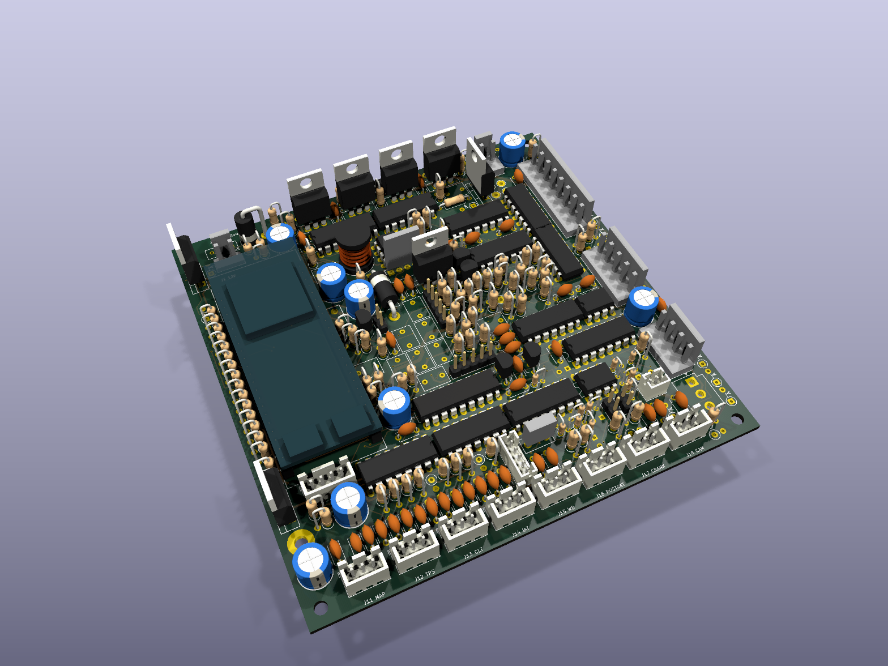
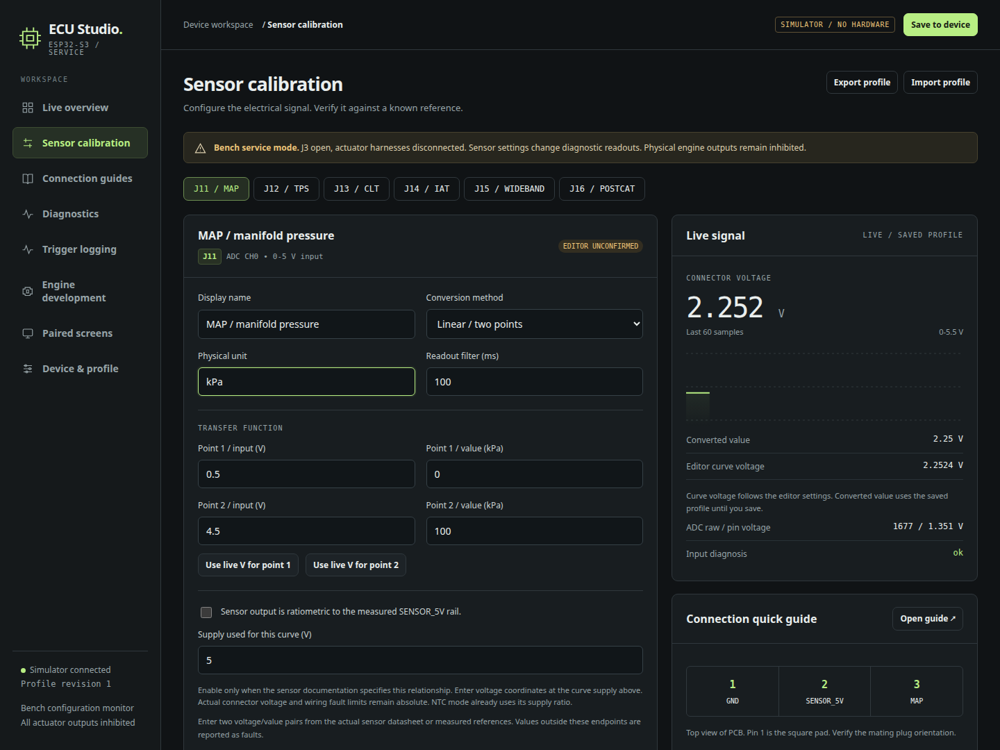
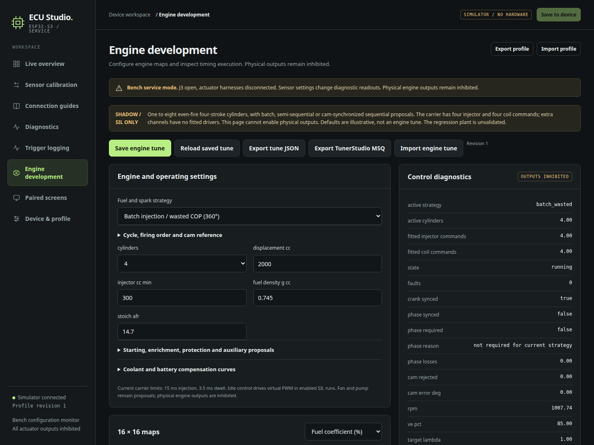
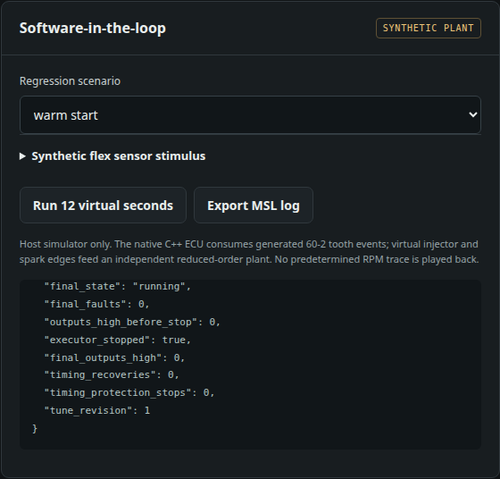
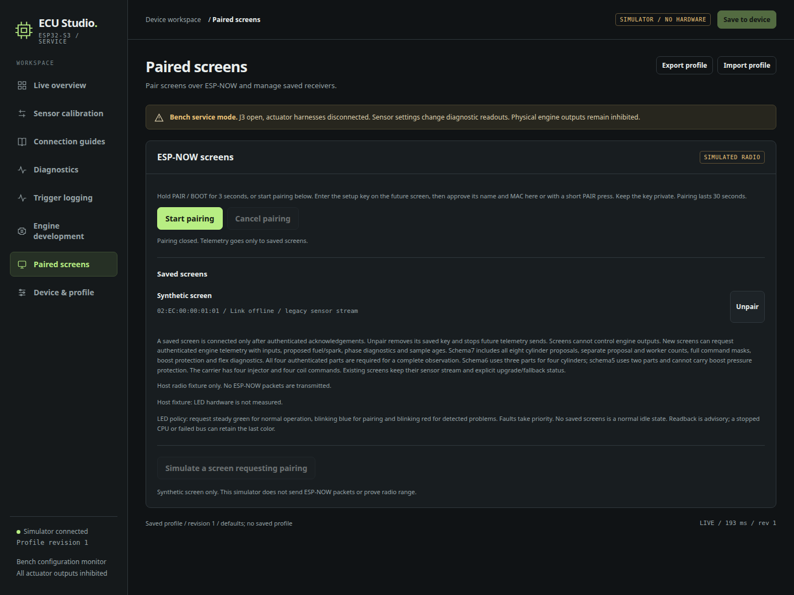

# ESP32 ECU

A home-solderable ESP32-S3 bench monitor and engine-control development platform. The project combines a compact through-hole carrier, ECU Studio in the browser, ESP-NOW screen telemetry, and a shared C++ fuel/spark core exercised with software engine models.

> **Current status: verified software/bench checkpoint.** Feature expansion is paused. All normal physical engine outputs remain inhibited. This is not yet a complete ECU that can run an engine or replace Speeduino.

[Checkpoint and evidence](docs/bench-checkpoint.md) · [Feature coverage](docs/engine-feature-coverage.md) · [Setup guide](docs/web-configuration.md) · [Latest hardware draft](hardware/a7-boost-interface/README.md) · [Tuning compatibility](tuning/README.md)



*A7 CAD draft, not a photograph or fabrication release. Some components use simplified envelopes or have no body model. The raised ESP32 module, header spacing, inward antenna reservation and enclosure fit remain provisional.*

## What it does today

| Area | Implemented capabilities | Current scope |
| --- | --- | --- |
| Sensor monitoring | Six protected analog inputs plus battery and 5 V rail measurement; linear, lookup-table and NTC conversions, 55 kΩ input-loading compensation and optional ratiometric calibration | Firmware and browser paths implemented; actual electrical behavior still needs measurement |
| Configuration | Persistent sensor profiles and engine tunes, import/export, strict validation, schema migration, stale-revision rejection and storage-fault reporting | Same parser/conversion code on target and host; defaults are uncalibrated |
| Crank and cam | Generic missing-tooth decoder, protected Hall interfaces, sync diagnostics and 720° sequential phase handling with cam-loss cuts | Firmware plus generated 60-2/cam events in simulation; target timing unmeasured |
| Fuel and spark | 1–8 virtual even-fire cylinders; batch/wasted, semi-sequential and sequential strategies; 16 × 16 fuel/spark/lambda maps and individual cylinder trims | Shadow calculations and software-in-the-loop (SIL), with physical outputs inhibited |
| Corrections and control | Cranking, warmup/afterstart, acceleration/deceleration, battery/dead-time/dwell compensation, rev limiting, overrun cut and bounded lambda PI; idle, boost/overboost, flex and secondary-table development | Implemented development paths with configuration and diagnostics; no physical actuator acceptance |
| Debugging | Raw ADC/rail/interlock status, listen-only CAN counters, bounded tooth/timing traces and engine logs, source/age/loss labels, JSON and MSL exports | Host checks pass; physical capture integrity and runtime load remain open |
| Paired screens | Authenticated read-only ESP-NOW sensor/engine telemetry; button or UI pairing, candidate approval and persisted unpair | ECU side implemented; screen firmware and real two-device RF tests remain open |
| Tuning tools | Own012 TunerStudio definition and offline MSQ editing; MegaLogViewer HD opens and plots current MSL files | Actual application/file workflows checked; supported online TunerStudio integration is unresolved |

**Shadow** means the ESP32 calculates proposed commands without driving engine outputs. **SIL** means the native C++ ECU receives synthetic sensor/tooth events and drives virtual outputs into a software plant. Neither establishes physical engine operation. The [full coverage matrix](docs/engine-feature-coverage.md) records the details and evidence for each feature.

## ECU Studio and test screenshots

The same local UI runs on the ESP32 service AP and the desktop simulator. These fresh Chrome captures use **synthetic host data**, with no hardware connected. The calibration curve is an unconfirmed example; the engine settings are illustrative defaults.

| Sensor calibration | Engine configuration and diagnostics |
| --- | --- |
| [](docs/images/readme/calibration.png) | [](docs/images/readme/engine-editor.png) |
| Signal conversion, input diagnosis and connector guidance | Four-cylinder default profile after a completed virtual run |

| Browser-driven engine test | Screen management |
| --- | --- |
| [](docs/images/readme/engine-sil.png) | [](docs/images/readme/paired-screens.png) |
| Actual **Run 12 virtual seconds** action, using the unvalidated reduced-order plant | Pair, approve and remove a synthetic screen; no RF packets transmitted |

[Capture sources, checks and image hashes](docs/images/readme/provenance.json) accompany the images. The requested LED policy is steady green normally, blinking blue while pairing and blinking red for detected problems, with faults taking priority. Browser tests verify the requested states, not physical light output. See [pairing, buttons and telemetry](docs/espnow.md).

## Hardware and revision status

- **Carrier:** 120 × 120 mm, six layers, through-hole assembly with ordinary leaded parts and directly soldered DIP devices. The ESP32 remains pluggable.
- **Selected module:** 44-pin Type-C **ESP32-S3 N16R8**, with 16 MB flash and 8 MB PSRAM. The [supplied listing PDF](hardware/references/esp32-s3-44pin-aliexpress.pdf) is preserved in the repository. Actual module/socket dimensions still need confirmation.
- **Fitted engine capacity:** four injector and four smart-coil command channels. Virtual cylinders 5–8 have no fitted drivers. There is no dumb-coil power stage or raw wideband-sensor controller.
- **Mechanical work:** printable screw-mounted enclosure sources, gasket concept and sealed PAIR/RESET button wiring are retained. Later module, antenna, harness and accessory changes still need physical fit checks.

| Revision | Where to look | Status |
| --- | --- | --- |
| A7 carrier + isolated idle/boost accessories | [Carrier CAD and BOM](hardware/a7-boost-interface/README.md), [shared harness and electrical work](docs/engine-boost-hardware.md) | Latest development draft; boost GPIO allocation remains inactive; no fabrication release |
| A6 flex/RGB and A5 idle work | [A6 layout](docs/engine-a6-layout.md), [idle isolation](docs/engine-idle-isolation.md) | Preserved development drafts with electrical/assembly holds |
| A3 board, manufacturing files and case | [Archived hardware](hardware/a3-compact/), [Gerbers/drills](manufacturing/a3/), [enclosure](enclosure/a3/) | Historical package; do not apply its wiring or fit assumptions to A7 |

## What it does not do

- **Run a physical engine.** The normal images keep engine commands and ARM inhibited. Injector flow/flyback, coil behavior, target timing, watchdog/reset behavior and loaded supply performance remain unqualified.
- **Provide the full Speeduino feature set.** Other OEM trigger decoders, raw VR conditioning, VVT, knock processing, staged injection, launch/flat shift/nitrous, stepper idle and autotune are missing. DBW and OEM CAN/immobilizer integration remain outside the current bench scope.
- **Offer supported online TunerStudio tuning.** The transport and offline file paths exist; online application acceptance is still unresolved. Offline MSQ and MegaLogViewer file compatibility do not prove a physical USB connection.
- **Establish engine-model equivalence or a usable calibration.** Comparisons execute pinned production Speeduino code, but retained reference runs still fail finite-step convergence checks. The plants are uncalibrated research models, and no engine has been tested.
- **Establish vehicle or enclosure qualification.** Physical RF/range, surge/EMI, thermal, current capacity, splash resistance and printed fit remain untested. CAD/ERC/DRC and passing software tests do not establish those properties.

## Work in progress and open items

Feature expansion is **paused at the verified checkpoint**, rather than complete. These are the remaining work areas when development resumes:

| Work area | Remaining work |
| --- | --- |
| Hardware release | Measure the real N16R8/socket/antenna geometry; resolve A7 and accessory electrical, exact-part, harness and enclosure holds before releasing matching fabrication files |
| Bench and HIL testing | Instrument real timing, ADC/supply behavior, interlocks, reset/watchdog recovery, dummy-load outputs and two-device ESP-NOW; then assess physical/environmental limits separately |
| Simulator comparison | Resolve failed reference refinements and matched turbo/map assumptions; preserve causal tests and numerical checks instead of treating a plausible RPM trace as acceptance |
| External tools and screens | Resolve online TunerStudio compatibility and physical USB checks; implement and test a separate screen receiver against the authenticated telemetry protocol |
| Broader ECU coverage | Add missing decoders and control features together with their hardware, UI, configuration, diagnostics and fault tests |

[Engine comparison and remaining convergence failures](docs/engine-shaft-integration.md) · [Current tuning evidence](docs/engine-tuning-application.md) · [Target timing limits](docs/engine-target-timing.md)

## Try the desktop UI or build firmware

The host needs Python 3, a C/C++ compiler and the pinned PlatformIO ESP-IDF package for its cJSON bridge. Follow the [setup guide](docs/web-configuration.md) for dependencies and bench wiring. Use a new output/state directory and a free port:

```sh
# Selected-module bench image. This does not flash a device.
python3 scripts/build_firmware_preserved.py \
  --environment compact_n16r8_web \
  --output .cache/engine/NEW-WEB-BUILD

# Same UI, synthetic measurements, no hardware connection.
python3 tools/web_server.py \
  --port 8765 --state .cache/engine/NEW-PREVIEW/profile.json
```

Open **http://127.0.0.1:8765**. On the actual device, service AP access requires J3 open at startup and a fresh per-boot password read from UART. The [guide](docs/web-configuration.md) covers power isolation and flashing. `compact_n16r8_flex_dev` requires its matching development wiring; `compact_a3_web` belongs to historical A3 hardware.

## What has been verified

The [checkpoint record](reports/engine/bench-checkpoint/README.md) contains the full native ASan/UBSan suite, **99 host/API/config/protocol checks**, sensor-storage fault tests, **four Chrome workflows** and **three fresh inhibited firmware builds**, with source/build hashes and independent review. No device was flashed. For this README, calibration, profile/logging and pairing browser checks were rerun successfully, followed by the captured four-cylinder SIL/UI workflow above.

The verified scope is software and declared bench paths. Physical hardware, RF, fit and engine operation remain open.

<details>
<summary>Historical A3 build package and earlier revisions</summary>

The original deliverables remain available for their original revision:

[Grouped BOM](hardware/a3-compact/BOM.md) · [Shopping CSV](hardware/a3-compact/bom-shopping.csv) · [KiCad project](hardware/a3-compact/esp32-ecu.kicad_pro) · [26-page manual](output/pdf/esp32-ecu-a3-build-calibration-debug-manual.pdf) · [Print files](enclosure/a3/) · [Complete A3 ZIP](build/esp32-ecu-a3-120-web-manual-case.zip)

[A3 native CAD checks](reports/a3/validation-summary.json) and [CAD enclosure-fit report](enclosure/a3/fit-check.json) are historical software/CAD evidence. They do not qualify a printed assembly or later hardware. Exact passive parts and some fit-dependent purchases remain flagged in the BOM.

[Revision history](docs/history.md) · [Original compact-board notes](docs/compact.md)

</details>
