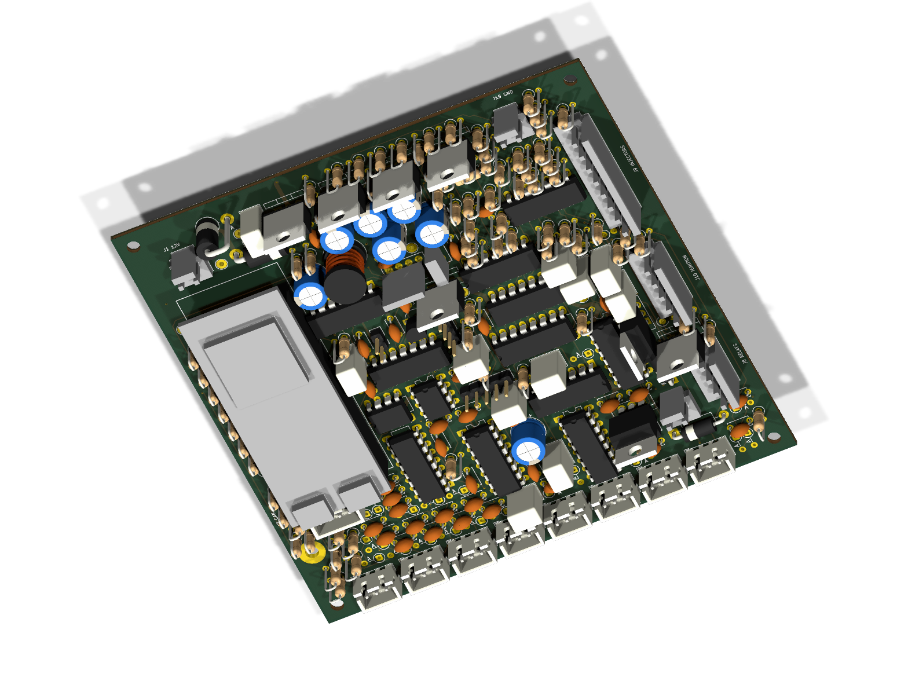
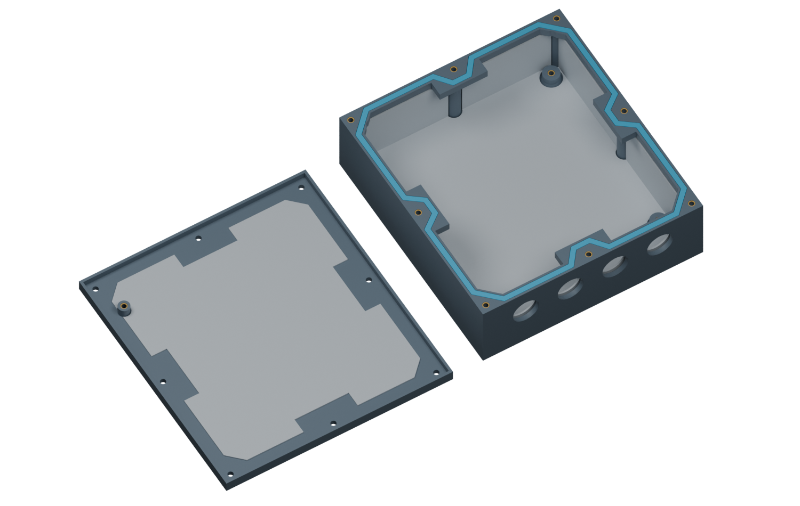
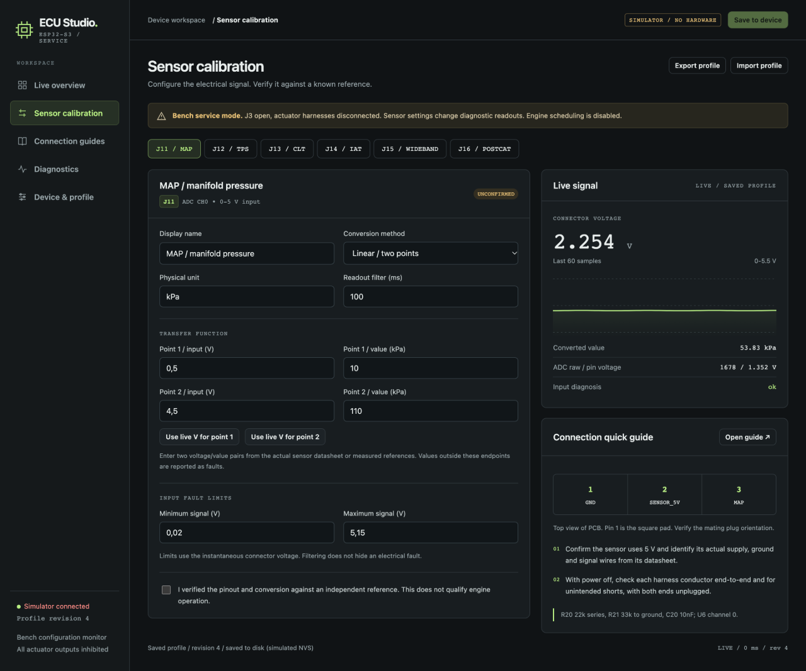

# ESP32 ECU A3-120

A 120 × 120 mm, six-layer, through-hole ECU development board with a plug-in ESP32-S3, configurable sensor readouts, live diagnostics and a printable gasketed enclosure.

**Bench prototype:** all engine outputs remain disabled. Vehicle operation, surge/EMI immunity and physical splash resistance have not been validated.

| PCB | Printable enclosure |
| --- | --- |
|  |  |

Configuration UI with simulated readings:



[Bill of materials](hardware/a3-compact/BOM.md) · [Shopping CSV](hardware/a3-compact/bom-shopping.csv) · [KiCad project](hardware/a3-compact/esp32-ecu.kicad_pro) · [26-page manual](output/pdf/esp32-ecu-a3-build-calibration-debug-manual.pdf) · [Print files](enclosure/a3/) · [Complete package](build/esp32-ecu-a3-120-web-manual-case.zip)

New development: [ESP-NOW pairing, screen management and sealed button wiring](docs/espnow.md). The UI can open pairing, approve a screen and unpair saved screens. Selected module: **44-pin Type-C N16R8**, with its [supplier PDF](hardware/references/esp32-s3-44pin-aliexpress.pdf) preserved. [A4 module-fit draft](hardware/a4-n16r8/README.md) has provisional socket dimensions; A3 manufacturing files and the old ZIP remain historical.

## Build and preview

With PlatformIO and a C/C++ compiler installed:

```sh
pio run -d firmware -e compact_n16r8_web
python3 tools/web_server.py
```

Open the desktop simulator at `http://127.0.0.1:8765`. Read the [web/bench setup guide](docs/web-configuration.md) before powering or flashing the hardware. The BOM identifies exact-part selections that still need review.

Local validation: [ERC/DRC and pin audit](reports/a3/validation-summary.json), [enclosure CAD fit](enclosure/a3/fit-check.json), [18 configuration/API tests](reports/web/config-tests.txt) and [116 control scenarios](reports/web/control-tests.txt). Some purchased-part 3D models are simplified assembly envelopes.

[Earlier revisions](docs/history.md) · [Compact-board details](docs/compact.md)
