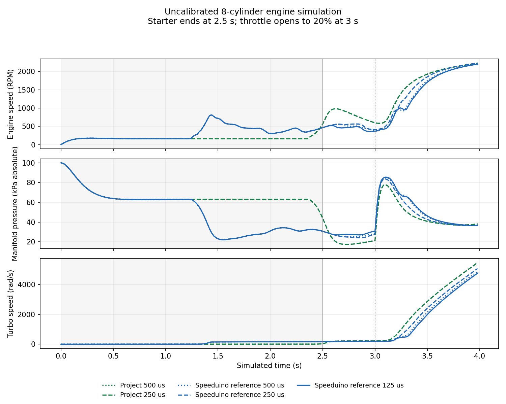

# Research shaft integration

The external research plants now integrate their declared starter/friction law without sampling the whole torque at the start of an interval. The previous discretization introduced a timing error before any fuel burned. A corrected mechanical step removes that particular first-order error; it does not by itself establish convergence of the complete hybrid controller/engine simulation.

## Equations and boundaries

The empirical parameters remain inertia0.18kg m², starter55Nm falling linearly to zero at350RPM, friction12+0.006RPM Nm and the existing opposing-load input. Released combustion work is still supplied only by physical spark events and the existing pending combustion pulses. No requested ECU pulse or desired RPM supplies shaft work.

Within one constant-input segment, the available combustion power is its released work divided by segment duration. Below20rad/s, the existing low-speed work fraction is integrated as a torque of power/20. Above20rad/s, shaft power equals available power. The unconverted part remains heat. The old method evaluated that fraction only at the initial speed; the new method integrates it over the actual motion.

Where torque is linear in angular speed, the solver uses the analytical exponential solution and its angle/squared-speed integrals. At higher speed with combustion power, it solves an implicit midpoint work-energy equation. It splits intervals at zero speed,20rad/s and the starter cutoff. A stopped shaft cannot reverse, accumulate friction work at rest or restart without sufficient torque. Heat, starter, friction, opposing load and kinetic energy remain separate inventories.

Per-cylinder shaft work uses each cylinder's share of released combustion work. Summing those entries must reproduce total delivered shaft work. The ledger names the method `piecewise_exact_linear_and_energy_midpoint_v1`; complete-run provenance also snapshots the new source module.

The integrator now also resolves intake closing before transferring port fuel into a frozen cylinder charge. Fuel delivered afterward stays in the port. Injector dead time and combustion-pulse endpoints split the physical interval, and wall fuel follows its analytical constant-source/evaporation solution. Subintervals partition the original duration in local coordinates; subtracting large absolute timestamps can otherwise consume a different amount of pending gas/shaft exchange energy.

The next closing is selected from canonical phase+720×cycle values and must be strictly ahead of the shaft. Quotient rounding can otherwise repeat or skip a fractional closing, including seven-cylinder phases. Exact and adjacent floating-point starts are tested with bounded solver calls, so a regression fails instead of hanging the suite.

This is a numerical correction to an empirical research engine. It does not calibrate inertia, friction, combustion, the starter or a physical actuator. Gas-path exchange, sharp mixture gates, sampled sensors and discrete native scheduling remain separate potential sources of sensitivity. Historical packets keep their original executing sources and results.

## Validation

`tools/test_shaft_dynamics.py` checks analytical cranking over four partitions, exact stopping/no work at rest, power equilibria,264 boundary/energy combinations, second-order high-speed refinement against a separate fine-step differential-equation solver, invalid inputs and an asymptotic boundary that rounds to equilibrium. `tools/test_intake_integration.py` checks causal charge capture, late injector opening, analytical wall transport, pulse endpoints, rollback after a completed intake event and pending exchange at a large absolute timestamp. The existing geometry, complete turbo composition, MVEM causality and cylinder-profile suites exercise the integrated model. Coupled project/reference refinement and charged shutdown remain separate tests; a passing pure-shaft check cannot substitute for them.

New complete runs retain `intake-events.jsonl` and `combustion-events.jsonl`. The audit checks their phase/time/identities and distinct actual coil falls. It independently replays injector flow, dead time, wall/port storage, intake closing, combustion and discarded charge into the final fuel inventory. Scheduled work and conversion heat have separate ledgers. The mandatory event contract comes from provenance and the attested source, so editing a result marker cannot bypass it.

```sh
python3 tools/test_shaft_dynamics.py --output NEW-SHAFT-TESTS
python3 tools/test_intake_integration.py --output NEW-INTAKE-TESTS
python3 tools/test_turbo_geometry.py --output NEW-GEOMETRY-TESTS
uv run --with 'fmpy==0.3.26' python tools/test_engine_profile_plants.py --output NEW-PROFILE-TESTS
```

Use a new output directory for every run. The [expanded boost fixture](engine-expanded-boost-reference.md) still executes unchanged pinned production controller objects. Failed complete-system refinements retain the unchanged2% threshold; they are not accepted as a converged comparison. Normal engine outputs remain inhibited, the fitted PCB remains4+4 and physical qualification is unfinished.

## Current comparison

The [reviewed correction packet](../reports/engine/shaft-integration/README.md) retains final500/250/125µs reference histories,500/250µs project histories and a reachable charged-coil fault. All selected project refinement metrics stay below0.025%. The reference still fails the unchanged2% gate:500→250µs differs by5.68% mean RPM/7.92% turbo speed, and250→125µs by7.60%/13.90%. These numerical corrections do not close the remaining reference sensitivity or establish a production controller bug.


