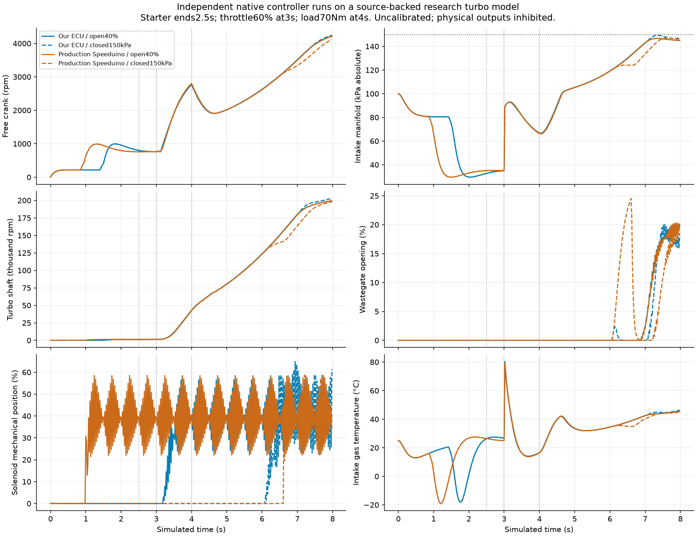

# Coupled turbo research benchmark

The own engine controller and pinned production Speeduino now drive separate turbocharged research plants through actual native fuel, ignition and boost-output transitions. Each engine starts from rest and generates its own crank teeth and sensor history. Physical engine outputs remain inhibited. The separate [A7/BOOST-DRAFT1 hardware increment](engine-boost-hardware.md) adds routed native sources and conditional circuit experiments; GPIO45 physical allocation and powered hardware acceptance remain open.

This extends [boost software/configuration/debugging](engine-boost-development.md) and the [naturally aspirated benchmark](engine-research-benchmark.md). The existing web simulator keeps its synthetic-data labels and its separate plant. These experiments do not silently replace it.

## Model and source

The component source is [TCSISimTestbed](https://github.com/nkymark/TCSISimTestbed) at commit `66a972d6c7206d258deb0c21b4cd6aded8a827e2`, associated with [Ng, Frisk, Krysander and Eriksson's engine fault-diagnosis study](https://arxiv.org/abs/2002.03201). The fetcher verifies the Git commit/tree, archive Git blob and exact extracted bytes. A strict local evaluator reads the selected scalar Simulink graphs, inherited defaults and mask scopes. It does not execute MATLAB code or claim complete Simulink execution.

Selected upstream maps/restrictions and six nonisothermal control volumes supply filter, compressor charge, intercooler, intake, exhaust and tail states. Their geometry is 1.8L. The local pulse-driven combustion, injector/coil, starter, friction and free-crank closure remains empirical. Source prescribed hot exhaust and turbo initial/minimum speeds are not imposed. Exhaust heat comes from fuel actually burned after delivered spark; pumping work and retired fuel cross explicit pending inventories.

The conservative component profile declares its departures from source:

- Compressor/turbine shaft power uses the same ideal-gas Cp as transferred enthalpy. The source's independent1100/1200 torque coefficients remain available in a negative-control profile.
- Below2000rad/s, finite turbine stall torque produces power only through actual shaft rotation. No rotor speed floor is applied.
- Turbine flow below300Pa pressure difference uses an explicit linear extension anchored to its source-map boundary.
- A stationary compressor has no map work. A declared passive restriction permits forward flow when downstream pressure is lower.
- The three-way boost solenoid, hose, diaphragm and spring are local uncalibrated hypotheses. Only executed binary GPIO edges energize their RL coil model. Requested duty never directly sets wastegate opening.

`TurboGasPath.step` integrates mass and sensible internal-energy increments with RK4, recovering temperature through the unchanged equation of state. Its rotor uses an integrating factor for linear bearing drag. The chain rule preserves the continuous volume equations, while avoiding mass/temperature discretization drift and a negative intermediate rotor stage during zero-speed startup. Invalid stages fail transactionally. There is no energy renormalization, hidden rotor clamp or injected exhaust heat.

The common enthalpy reference is ambient temperature. Ledgers include external sensible enthalpy, fuel mass, combustion work/heat, cooler heat, bearing loss, pumping exchange, kinetic energy and pending transport. Conservation tests establish bookkeeping for this composition. Turbo maps, wall heat transfer, cylinder dynamics, combustion, sensor transfer and actuator parameters still require calibration. Surge, knock, emissions and physical engine response are outside this model's proof.

## Controller profiles and clocks

The declared bench profile uses four cylinders, 1.8L,300cc/min injectors, gasoline AFR14.7, VE85%, running spark10°, cranking spark5°, target lambda1, deadtime0.9ms and dwell2.8ms. WUE/cranking corrections are100%; ASE, EGO and DFCO are off. These settings isolate execution and are not a physical engine base tune.

Both controllers receive a60-2 crank stream generated from their own free shaft. The actual production reference is pinned at `9ff5aae44de51fdc00d3fb1c7c2bfc1f0d0b3e20`, built without `UNIT_TEST`. Its production setup, EEPROM reload, ADC conversion, decoder, controllers and schedulers execute. The builder proves the original109-object link, reuses108 objects and replaces only the native experiment entry point. Neither project injects a desired RPM, sync state, PID output or scheduling mask.

The own controller samples at5ms and progresses its shared target dispatcher at1ms, with timer events delivered between those boundaries. The reference's main loop uses an explicit1ms absolute virtual calendar independent of gas integration calls. Hardware timer events and actual primary decoder callbacks remain separate. A regression with identical raw inputs and crank events proves identical full reference output histories across250/500/1000µs caller subdivisions.

The reference retains its production30Hz/10Hz flag gating. Fixed cadence can delay closed-loop target updates; its gains, activation, TPS/RPM gates, quantization and recovery semantics differ from the own controller. Both profiles use24Hz nominal boost frequency, with explicit4µs reference timer quantization. Source open-loop drive can continue at conditions where the own supervision gates it. Equal numerical fields do not establish equal PID behavior.

The inherited neutral reference profile sets its protection RPM cap to6500. Source overboost protection reduces the allowed RPM; below that cap, the main loop can clear the indication when no scheduler cut is active. The real-gas overboost experiment explicitly lowers the pressure threshold to140kPa, uses a130kPa target table and sets the reference protection cap to0RPM to enable full engine-cut masks. The reference can finish already active injector/coil pulses and retain boost PWM while rotation remains Running. Actual edges establish those timings. These are authored bench settings, not factory-default Speeduino behavior. No sensor-value override produces the pressure crossing.

Native CPU execution cost is zero. The source's initial timer compare is explicitly armed at zero; an unarmed `UINT32_MAX` negative control remains available. No AVR/ESP32 CPU timing, RTOS latency, target interrupt wiring or real electrical execution is established.

## Raw inputs and trace interpretation

The reference input adapter accepts bounded finite research temperatures and converts them through its declared calibration to10-bit ADC counts, saturating at0/1023. Cold gas-model transients can therefore rail a sensor curve. Huge/nonfinite values and malformed clocks/edge rows are rejected. Traces retain supplied physical values, actual ADC readback, production controller readings and independent gas state.

In particular, source MAP polling rejects rail readings and can retain its previous valid MAP. A400kPa input fixture becomes ADC1023. It tests sensor-failure policies; it does not prove that production measured400kPa, or that the gas actually reached an overboost threshold. Own qualified-unit input checks and source ADC filtering are distinct paths.

Every output event has a sequence and cause. Snapshots record the exact consumed prefix, and all same-time events are drained before observing the actuator. Audits reconstruct GPIO state, edge counts, coil current, energization and energy. The `before_halt` state and ledger are captured before any terminal intervention. `fixture_halt` and `cut:simulation_end` remain explicit manual termination causes and provide no evidence of natural shutdown.

In this turbo composition, global GPIO-low cuts use the same injector/coil falling-edge model as individual transitions. A previously charged coil can therefore discharge and burn trapped fuel after an ignition-cut request. `cut_discharges` records its modeled dwell, energy and combustion contribution. The charged-coil fault waits until a real free-engine coil has charged for at least1.5ms, then applies the declared MAP-rail fixture. It does not seed RPM, cylinder fuel or coil energy. The earlier naturally aspirated plant's ideal external-quench assumption is separate and must not be used to infer real charged-coil cut behavior.

Each run freezes imported project sources, ECU headers, configuration and model inputs. The own executing shared object must match a separate fresh dependency-discovered rebuild byte for byte, including its actual mapped file/inode and compiler identity. Reference binary and full build-manifest bytes bind its original inputs. Inputs are checked before and after execution.

## Run and inspect

Keep the original Speeduino checkout and historical artifacts. With the existing native prerequisites described in [engine development](engine-development.md):

```sh
export CC=gcc CXX=g++
python3 scripts/prepare_tcsi_source.py
python3 scripts/build_speeduino_sim.py
python3 scripts/build_speeduino_turbo.py --output .cache/engine/turbo-reference
ECU_SPEEDUINO_TURBO_BIN=.cache/engine/turbo-reference/speeduino-turbo-sim \
  PYTHONPATH=tools python3 -B -m unittest -v test_speeduino_turbo
python3 tools/run_boost_matrix.py \
  --output .cache/engine/turbo-study \
  --reference .cache/engine/turbo-reference/speeduino-turbo-sim \
  --suite all --jobs 4
python3 tools/verify_boost_engine.py .cache/engine/turbo-study/open-40-ours/run
```

Every output directory must be new. The full suite runs28 independent experiments: off, zero/open/closed drive;500/250/125µs open-loop and500/250µs closed-loop sensitivity; throttle closure/reopening, missing crank capture, MAP rail, disconnected solenoid and stuck-open gate, plus charged-coil fault and actual research-gas overboost pairs. The common stimulus ends starter assistance at2.5s, opens to60% throttle at3s and changes resisting load from5 to70Nm at4s. Fault intervals and actual delivered/suppressed teeth are recorded separately.

Run artifacts include `tune.json`, `trace.jsonl`, `edges.jsonl`, `trigger-stimuli.jsonl`, progress/results and full source/build provenance. `analyse_boost_runs.py` produces comparison metrics, and `plot_turbo_study.py` exports research figures. Component tests retain the raw-source power-defect negative control; complete-run energy tolerance remains0.02J.

## Current acceptance

The [frozen evidence packet](../reports/engine/turbo-coupling/README.md) contains28 completed runs,11,200 independently audited snapshots, exact executing-source/build identities, raw edges and a standalone integrity/replay verifier. The independent review accepts numerical/adapter/common-actuator consistency for these declared Linux native experiments, with no open findings in that scope. All61 focused tests pass.

The maximum complete energy residual is9.70µJ against the unchanged0.02J gate; maximum mass residual is1.95×10⁻¹⁵kg. All six declared time-step comparisons pass their2% limit, with a largest measured difference of0.238%. These are finite profile checks, not a calibrated-engine prediction or uniform convergence proof.

The actual-gas140kPa experiment reaches protection at the first saved own/reference snapshots at6.900/6.940s. The own controller has all engine outputs low and boost off; the reference has zero scheduling masks but its existing pulses finish by6.941640s and boost PWM continues while Running. The charged-coil fixture independently reaches real stored charge in both plants. Its own cut discharges two54mJ coils; the modeled combustible cylinder releases1425J. Those are simulated quantities, not electrical measurements.

The first review closed build-provenance and same-time snapshot findings. Fault experiments then exposed energy drift, a zero-speed RK stage and a rejected cold sensor transient. A subsequent24-case revision passed numerical/trace checks, but an independent charged-coil counterexample prevented adapter acceptance. The corrected28-case study closes that finding through common falling-edge physics and reachable fault evidence. Rejected experiments and reviews remain retained.

The original28-case aggregate is also preserved with its failed author-audit result: its parent process had loaded a verifier that compared a decimal-string64-bit counter with an integer. A fresh verifier corrects that type handling, rechecks all28 runs, and binds198 original inputs plus its own source hashes in a separate appended result. No trace or original audit was overwritten. The independent review checks both records and recomputes the physical budgets itself.



Fault and shutdown figures, reproduction details and the review are linked from the packet. These results do not establish full Speeduino parity, physical operation or calibrated turbo/engine behavior.

Protected boost hardware/CAD, calibrated actuator/engine data, full target/ADC/HIL measurements, physical engine outputs and wider feature/tuning-application acceptance remain open in the [feature ledger](engine-feature-coverage.md).
