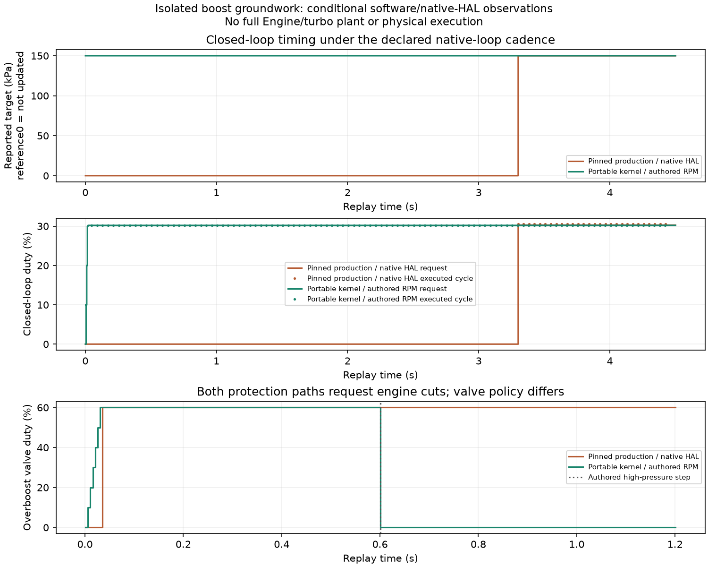

# Boost groundwork checkpoint

This is an isolated portable boost/overboost core and supervised PWM, plus genuine pinned Speeduino source probes. **It is not connected to the engine tune, target, UI, USB tuning, logs or screens.** The running ECU still enforces the existing NA110kPa pressure policy. All physical engine outputs remain inhibited.

[Contract, source references and reproduction](../../../docs/engine-boost-development.md) · [Independent review](independent-review.json) · [14-case results](results.json) · [Archive/source/build manifest](manifest.json)

The core implements separate8×8 open-duty, absolute-pressure target and feedforward tables, physical-unit PID with derivative on measured pressure, antiwindup/rate limits, pressure latching/hysteresis/recovery and explicit validity/time/stop gates. Pressure protection may stay enabled with valve control Off. The inactive/spool path is separately configured and defaults to zero. Its opt-in direct-duty behavior is documented; active-control slew does not apply there.

The shared PWM primitive now has compile-time period limits. Idle retains its original2500..50000µs envelope; boost uses20000..100000µs. Instances keep independent state and retain immutable20ms freshness,25µs lateness and explicit supervised-zero recovery. The GPIO45/U3.37/J24 hardware interface is an **unrouted candidate**, with module strapping, buffering/RUN loading, protected solenoid stage, fit and all physical tests outstanding.

| Check | Result |
| --- | --- |
| Native core/PWM ASan/UBSan assertions |162 pass|
| Interface candidate/parent tests |3 pass, including rejection of existing RGB J23|
| Genuine production-source / portable-kernel paired probes |14/14 declared expectations pass|
| Independent old/current idle behavioral observations |759600 exact comparisons pass|
| Independent analytical/randomized kernel/PWM checks |500281 assertions pass|
| Actual fake-target service modes |4 pass|
| Preserved web firmware builds |A3, N16R8, flex-development pass; exact BIN/ELF retained|
| Flex-development static ISR placement |31 reachable functions pass static audit; no latency measurement|

The reference uses raw ADC and genuine missing-tooth callbacks; its RPM is decoder-derived. The own side authors RPM/running and executes only the new kernel/PWM. Gains and startup semantics are declared fixtures. This is not the requested full engine/turbo-plant comparison.

The generic native timer's default `UINT32_MAX` compare produces a nonzero boost-duty request without executed edges. A separately declared reset-to-zero virtual compare allows PWM execution; the untouched default remains a negative witness. The source/controller objects and original numerical binary are unchanged. This is a HAL initial-condition issue, not a claim about physical Speeduino hardware.

Under the fast native loop, the pinned controller's nested33ms/100ms gates first update the closed-loop target at3.3s. Long positive and below-activation probes retain that delay and continue past it before asserting PWM/gate behavior. Independent1ms observations reproduce the first target at3300000µs. The overboost witness preserves another policy difference: reference scheduling masks cut while its valve request remains60%; the portable kernel requests engine inhibition and valve zero. No kernel boolean is presented as completed full-engine execution. TPS raw units, the table's Y-axis factor and physical-percent duty agree within integer quantization.

Archives contain current/exact firmware-build sources, full accepted paired inputs/outputs, bounded independent probe sources/results and exact firmware BIN/compressed-ELF images. Linked Speeduino binaries/objects and upstream GPL source are excluded. Reference regeneration requires the separately attested pinned numerical cache/source checkout. Earlier failed exploratory probes remain intact locally and are excluded from accepted results. The firmware images predate three extra assertions in an uncompiled native test; the exact earlier/current test versions are both retained and disclosed.

The next implementation must carry the pressure envelope, core, PWM ownership, cuts and diagnostics through whole-tune migration/storage/CAS, browser/TunerStudio controls, logs/screens and a coupled turbo/wastegate engine benchmark. The current8192-byte tune page has only224 tail bytes. GPIO45/module identity and strapping, actual timing/flash/RF load, driver/coil/plumbing/current/thermal behavior, HIL, assembly, enclosure and vehicle qualification remain open. This checkpoint closes none of those gates.
