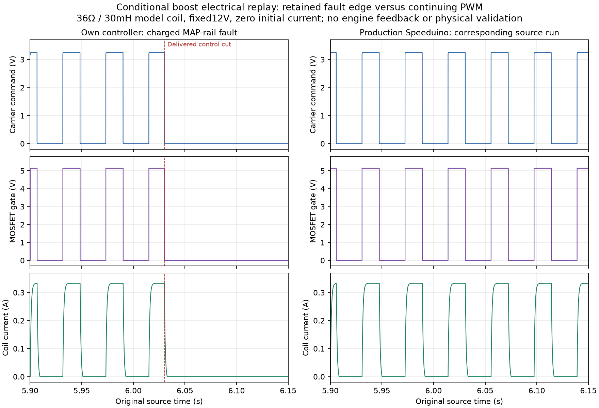

# Reviewed boost hardware development checkpoint

The separate A7 carrier and BOOST-DRAFT1 accessory have reviewed native CAD and30 conditional full-stage circuit cases, including actual nominal/charged-cut/overboost controller-edge prefixes. Both boards pass independent all-severity ERC/DRC/connectivity/parity checks. Source A6/IAC records remain unchanged. Physical engine outputs remain inhibited and GPIO45 is unallocated.

See [the hardware guide](../../../docs/engine-boost-hardware.md), [summary](summary.json) and [feature ledger](../../../docs/engine-feature-coverage.md). The archive contains exact source/build identities, reviewer-selected evidence, original routing findings, corrected routing and the earlier nominal-only replay tool. Independent review audited2,318,987 final raw rows. Raw controller edges and source snapshots are included with the model experiments.

[Own charged-fault full trace](charged-own-full.tsv.gz) and [reference full trace](charged-reference-full.tsv.gz) retain every original column/row. Other cases publish exact selected diagnostic windows with explicit selection rules and full raw hashes; all complete raw traces remain in the local cache. Quantitative metrics come from the complete independent audit, not the selected plots. The previous replay filter omitted control-cut causes; the corrected runner preserves them and rejects fixture shutdowns.



The coil, optical threshold/pole, MOSFET/driver/supervisor and sources are conditional models. There is no engine feedback or physical timing/current/temperature guarantee. Combined RUN loading, procured-package bounds, actual minimum pulse, valve/protected branch/independent disconnect, target/HIL, ordinary-iron assembly, enclosure, RF and wider feature/tuning-application acceptance remain open. No manufacturing release is made.

Verify the closed archive inventory and optionally current project sources:

```sh
python3 reports/engine/boost-hardware/verify.py --verify-only --output reports/engine/boost-hardware --repo .
```

This verifies file/payload integrity and declared scope. It does not reproduce the physics, rerun KiCad or qualify hardware. Reproduction commands and assumptions are in the hardware guide.
