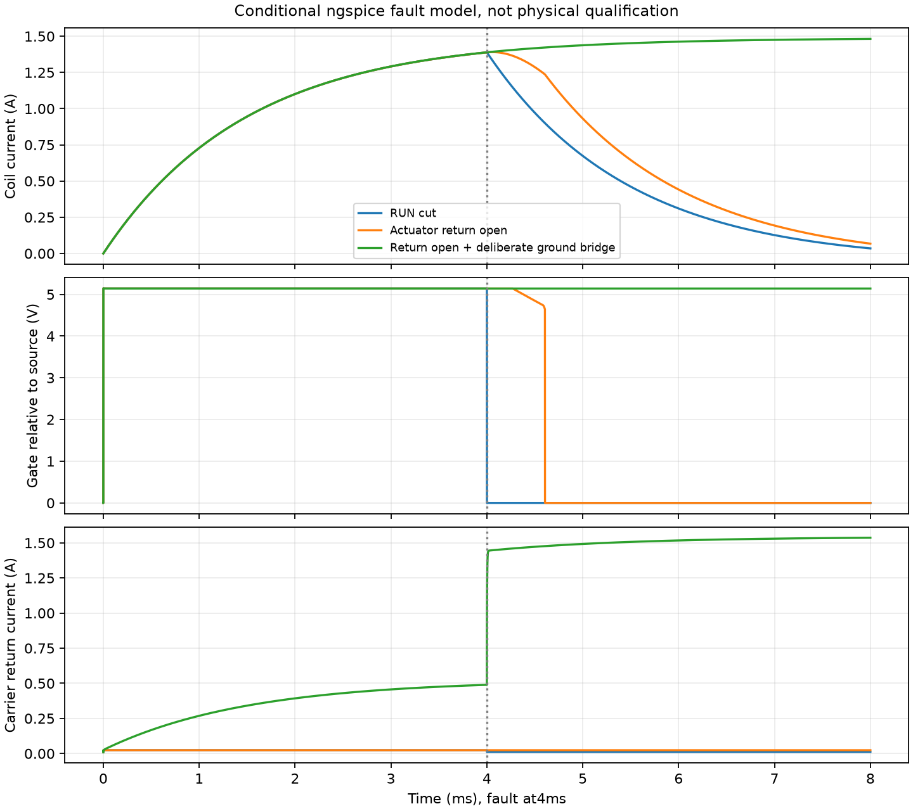
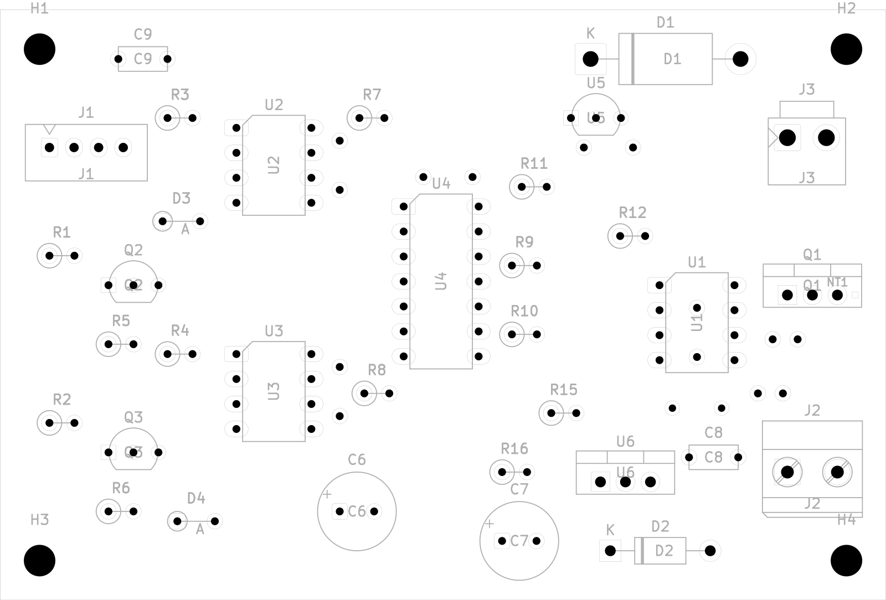
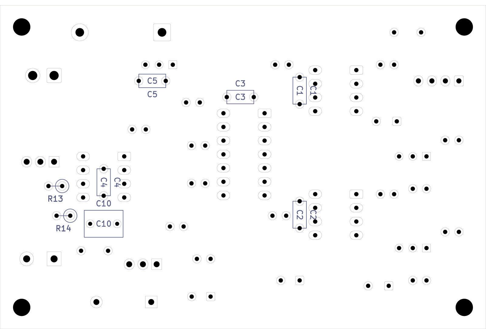

# Idle interface hardware evidence

This bundle covers the routed A5 carrier delta, isolated IAC-DRAFT2 accessory, UI/debug-guide update and conditional circuit experiments. **Physical outputs, fabrication and powered valve integration remain inhibited/on hold.** It adds no new closed-loop engine run; the earlier [33 engine runs and38 Speeduino checks](../idle-control/) remain separate evidence.

| Check | Result / boundary |
| --- | --- |
| A5 carrier | ERC0, DRC0, unconnected0, parity0. Original219refs/661pads/2973copper objects retained, except intended U3.13 net change;25 new copper objects |
| IAC-DRAFT2 | ERC0, DRC0, unconnected0, parity0.47refs/123 electrical pads, including unfitted copper star; all fitted electrical parts THT |
| Independent copper review | Initial bypass/shared-return defects corrected; sole logic/power return join at Q1 source; all15 broad power segments and31 local seeded segments retained |
| Nominal assembly projection | Eight back bodies have no front solder-pad overlap. C4 lead ends require trim/inspection before front DIP assembly. Exact3D/finished-hole/case fit unmeasured |
| Conditional circuit model | 25 ngspice45.2 runs,9 consequence checks, all complete. Eight independent controls and raw-data audit are in the circuit review |
| UI/configuration | 20 configuration/API tests,13 idle tests and9 Chrome workflow checks, including320/390/768/1440px layouts |
| Target builds | N16R8 web and A3 web build; ISR placement and USB ownership audits pass. Static checks do not measure hardware timing or runtime margins |

Use [validation-summary.json](validation-summary.json) for live-source/build bindings and [artifact-manifest.json](artifact-manifest.json) for every published artifact's bytes. Raw circuit decks, logs and full saved trace windows are in [circuit/](circuit/). Pulse traces retain1.9–2.2ms around their2ms command edge; the solver still integrates from zero. Other warm traces retain0–8ms; cold startup retains0–0.8s. `numdgt=17` preserves exported time ordering. Averages are time-weighted over declared windows. All25 exports have strictly increasing times.

The circuit is a separately authored lumped network with generic semiconductor and conditional opto/logic/supervisor/regulator behavior. It is not a vendor macromodel, parasitic extraction, valve-mechanics model or engine coupling. Cold startup applies DC carrier5V to an initially uncharged ideal100nF while the actuator source ramps. The sampled carrier inrush depends on ideal wiring/capacitance and timestep, and is **not a physical peak-current bound**. Late currents are reported separately. The deliberate ground bridge and drain-source short remain unsafe negative controls.

The gate can remain high briefly after an actuator return opens while the local rail discharges. A ground bridge can divert coil current into the carrier. The plot is a conditional model result, not a measured shutdown guarantee.

| Nominal top assembly | Mirrored back assembly |
| --- | --- |
|  |  |

These are native fabrication-layer illustrations, not manufacturing exports or a3D fit certificate. Plotting runs sequentially on writable cache copies because KiCad may write project settings. The source project bytes remain unchanged.

Independent records:

- [Architecture review](reviews/architecture/review.md) and its arithmetic/truth/DC-graph probe. Its preliminary RUN budget is superseded by the combined-loading finding below.
- [Initial copper findings](reviews/layout/initial-review.md), [final accessory review](reviews/layout/review.md), immutable snapshots and probes. Final raw results are in `reviews/layout/assembly-final/`.
- [A5 preservation/interface review](reviews/layout/a5/review.md), independent raw-S-expression audit and source-loading calculation.
- [Circuit review](reviews/circuit/review.md), independent controls, trace audit and exact source/artifact hashes.

Review scripts retain their original `.cache/engine/...` execution paths as provenance. For replay in a fresh checkout, restore each exported review tree to its named cache directory, point `snapshot-path.txt` files at the restored immutable bundle, then run its captured native-check runner/probe on writable cache copies. Preserve published evidence directories. Source PDFs, extracts and rendered datasheet pages remain local research inputs and are not redistributed. Pinned official KiCad footprint source copies retain the [KiCad library license/exception](https://www.kicad.org/libraries/license/); project-copy attribution is also in the hardware library notices.

**Release holds:** combined RUN/Q7/HCT source loading, loaded GPIO including R154, actual module/eFuse/JTAG geometry, exact PDIP driver guarantees/passive parts,1µs pulse/brownout behavior, independent protected actuator cutoff, actual valve R/L/current/decay, thermal, finished holes/lead trimming/back-part height, enclosure/RF/sealing. The [hardware guide](../../../docs/engine-idle-isolation.md) explains the implementation and reproduction. Nothing here establishes physical engine/vehicle, surge/EMI, thermal, splash or printed-fit qualification.
