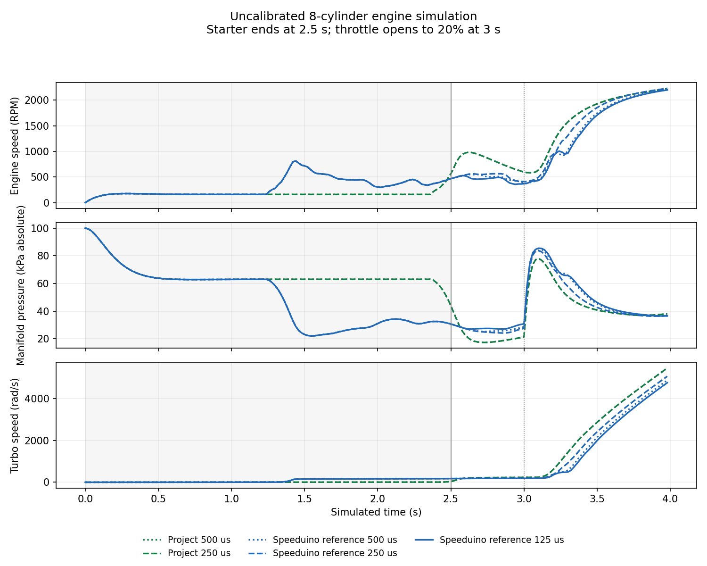

# Research shaft and intake correction

The engine research plant now resolves intake closing before trapping fuel, integrates constant-source wall transport, and advances starter/friction with an analytical linear solution and conservative power step. Local elapsed durations preserve pending gas/shaft energy exchange. These numerical fixes improve the test method; the full ECU goal remains active and normal engine outputs remain inhibited.

The two finite reference-refinement checks **fail** the unchanged2% gate. The manifest retains each result separately; neither the figure nor a passing invariant audit establishes calibrated physics, controller equivalence or positive-boost tracking.

- `sources.zip`: source overlay on `bbf7ba5`, reproduction and method limits.
- `validation.zip`: analytical/ODE/causal-boundary tests, all48 quick/MVEM cylinder-strategy profiles, integrated regressions and independent review. Rejected stages retain their own source snapshots and counterexamples; their full raw cached histories are not standalone public packets here.
- `runs.zip`: six final parent cases plus an independent one-cylinder reference case, with full source/model inputs and actual intake/combustion records. Project shared libraries permit packet-only auditing; reference binaries, object/coverage files and proprietary applications are excluded.

The event audit independently replays actual injector transitions through dead time, wall/port fuel, intake closing, combustion/discard and final storage. It checks distinct actual coil falls and separate scheduled-work/conversion-heat inventories. Earlier rejected time/accounting and event-tamper cases stay rejected. Seven extracted case packets must pass the same audit before publication.

See `docs/engine-shaft-integration.md` in the source overlay. Matched turbo/maps, remaining engine features, protected PCB expansion, supported online tuning and target/physical validation remain unfinished. The fitted carrier is still4+4. No physical engine, vehicle, electrical, EMI/surge, thermal, splash, RF or printed-fit qualification is claimed.
