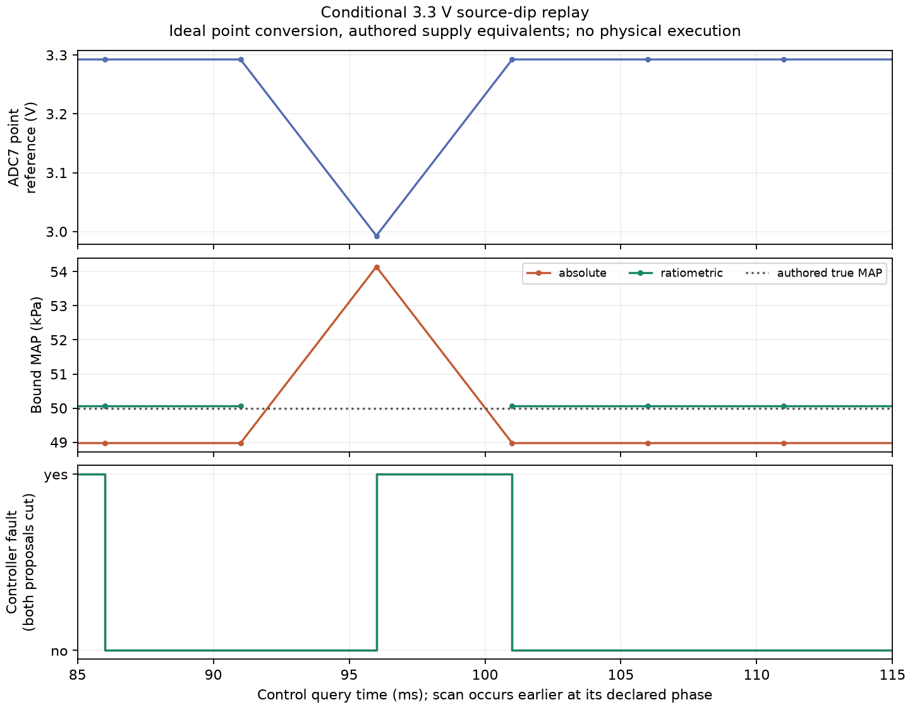

# Conditional supply and acquisition checkpoint

This study sends authored A6 circuit waveforms through the actual portable sensor binding, flex capture and engine controller. It completes26 scenarios at1µs and0.25µs maximum steps, with four assumed GPIO threshold pairs, three engine strategies, two calibration bases and ten integer-clock phases. All physical engine outputs remain inhibited.

[Method, assumptions and reproduction](../../../docs/engine-supply-disturbance.md) · [Results](results.json) · [Cross-grid comparison](comparison.json) · [Archive/source manifest](manifest.json)

- Both complete raw matrices pass strict finite/time/end checks and the strengthened independent data-chain audit.
- All sampled ADC codes, query timing and threshold/clock-quantized GPIO inputs agree across the two grids. Their native controller observations agree exactly after excluding only the independently recorded analog-reference debug value.
- An independent ASan/UBSan rebuild reproduces all1248 native JSON transcripts and MSL logs byte for byte, with empty stderr. All23 authored tests and26 independent acceptance/rejection controls pass.
- The review found and drove fixes for missing/duplicate replay acceptance, swapped threshold/file identities, trusted sampling metadata, dimensions-only MSL checks, false retention headers and unbound circuit decks. It also verified recovery of an inherited source file against its recorded pre-run hash. Review findings and reproductions are archived separately from intentionally corrupted local fixtures.

The deliberately short original ripple bursts miss acquisition and remain negative exposure controls. Added bursts cover MAP, rail and whole-scan windows. Delivered perturbations are checked separately:5V source bursts overlap acquisition but do not change this fixture's MAP/ADC7 point codes; the3V3 bursts do affect reference samples/codes. Source overlap alone is not evidence of a meaningful ADC error.

Ratiometric conversion reduces supply-related MAP error in these point-conversion fixtures. It does not bypass the engine's numeric rail guard. The60mA external sink with4.5Ω F2, and40mA sink with7.5Ω F2, both cut every controller observation despite plausible normalized MAP. These currents are authored external sinks plus the modeled divider/NTC loads, not released sensor-current ratings or PTC trip tests.

Only ADC7 has a switched hold equivalent. Conversion uses an ideal held-signal/instant-reference point, with authored acquisition/conversion windows, rather than a physical MCP3208 SAR model. Reference-span-in-LSB is an indicator, not an ADC error bound. Supply/return impedances, ESR/ESL, loads, coupling, diode equivalents and GPIO thresholds are unmeasured assumptions. RPM/synchronization are fixtures. No ESP32 CPU, crank decoder, scheduler, hardware driver, regulator control loop, PTC heating/trip or engine plant executes here.

The archives retain exact frozen/current study sources, original run metadata/decks/sampling/solver logs, complete audit reports/comparison, and a strict whitelist of independent review sources/results including private cJSON build inputs. The full raw waveforms and native transcripts/logs, and all executables, remain intact in local run013/run014 directories identified by the manifest. They are **not distributed in this compact packet**. A raw audit on another machine requires rerunning the documented complete matrices with the recorded toolchain; hashes alone do not reproduce waveforms or establish physical correctness.

Future runs now retain the inherited A5 contract directly. Earlier runs recorded its exact hash before execution; the auditor recovers matching bytes separately without changing those original run directories. The frozen producer and current source-retention follow-up are both included.

Physical power/reference quality, actual thresholds/delays, timing/RF/flash load, driver energy/heat, HIL, assembly, enclosure and vehicle qualification remain open. This checkpoint does not complete online TunerStudio integration or the wider Speeduino feature objective.
