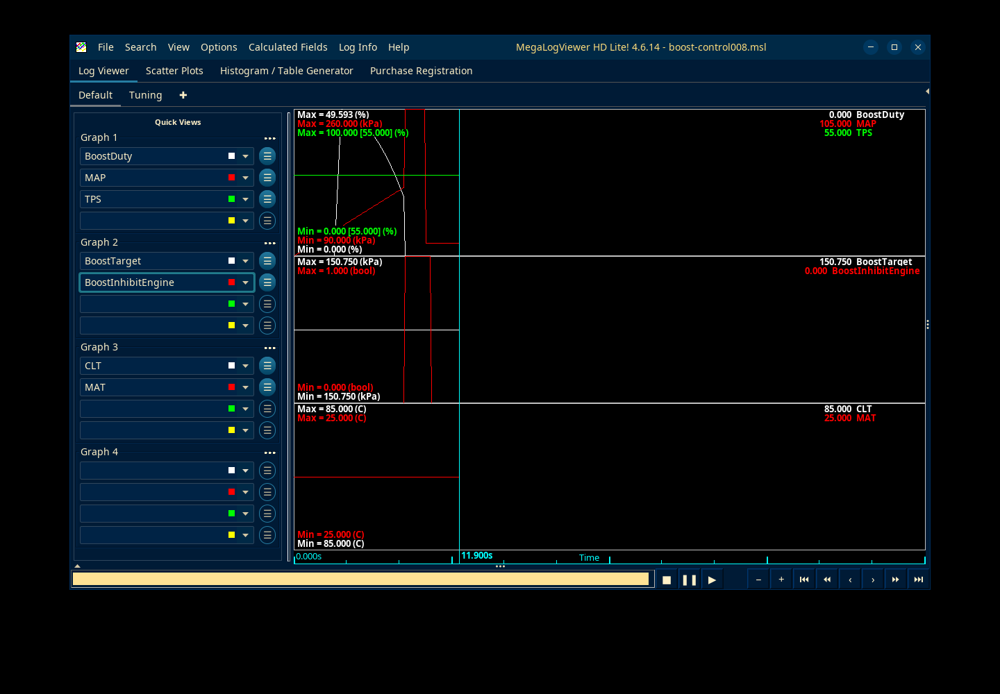

# Current own011 / MSL008 application checkpoint

Actual TunerStudio MS Lite3.3.01 loads/edits/saves own011 offline. Three intended table edits survive, and a fresh latest-definition reload/save reconstructs all12288 page bytes with an explicit known origin7. The202 saved constants omit the read-only origin. Ten Chrome checks include importing that real application file with CAS and preserving every calibration field.

The original Python MSQ gave percent units to three boost option fields. The actual application's warnings are retained alongside the corrected unitless export. Current general editor bounds now cover33 scalars, six curves and three timing fields, including four-cylinder support and5..45° cam window; whole-tune validation still handles coupled rules.

**Online remains unsupported:** the fresh own011 trace has1685 complete CRC-valid discovery exchanges and337 exact rejection warnings, with no calibration/runtime/read/write/burn operation. No other controller identity was used. The genuine production Speeduino positive control remains in the separate historical packet. The vendor request/ZIP are prepared locally and unsent.

MegaLogViewer HD Lite4.6.14 plots current245-column MSL008 BoostDuty/MAP and protection fields from120 synthetic controller observations. A separate trial opens300 rows of202-column direct-SIL008 and plots BoostReason6..8, matching the raw file. This is viewer file/field evidence from the existing unvalidated regression, not a new engine benchmark. Its calculated AFR* summary also reports a14,700,000 maximum when ten raw Lambda fields are unavailable. Raw JSON/MSL validity remains authoritative; huge-counter graphical arithmetic is unverified.



[Current guide](../../../docs/engine-tuning-application.md) · [USB/layout and power restrictions](../../../docs/engine-usb-tuning.md) · [Summary](summary.json)

Archives preserve sources, actual files/logs/screenshots/actions, initial warning evidence and reviewer-selected probes. Vendor binaries, definition PDFs and personal registrations are excluded. All owned application/Xvfb processes are terminal. There was no physical serial connection, flashing or engine operation.

Verify immutable files/payloads:

```sh
python3 reports/engine/tuning-apps-011/verify.py --verify-only --output reports/engine/tuning-apps-011
```

Add `--repo .` only when current project source bytes still match this checkpoint. This is an integrity/scope check; it does not relaunch the proprietary applications or certify controller physics. Reproduction source/action scripts are archived with the installed versions' hashes. The full ECU goal remains active.
