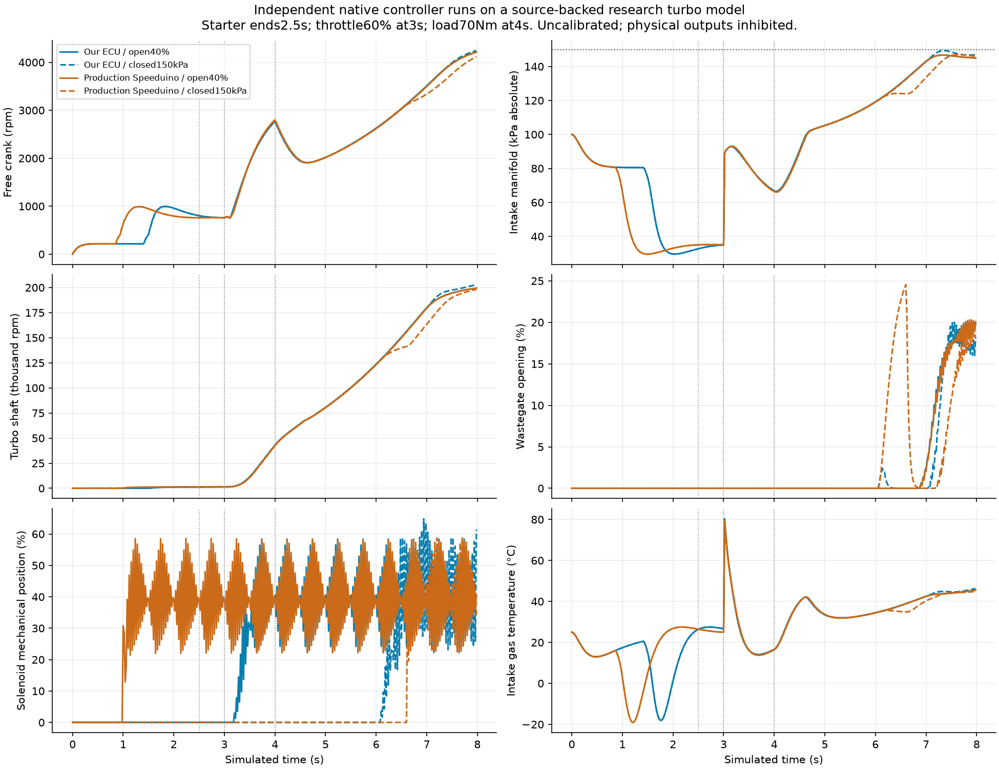
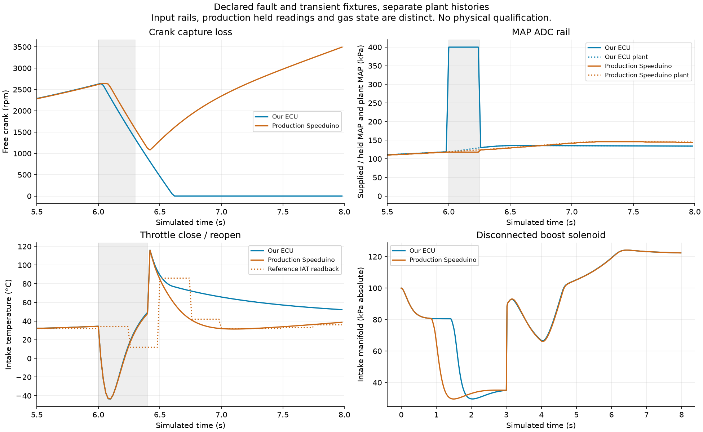
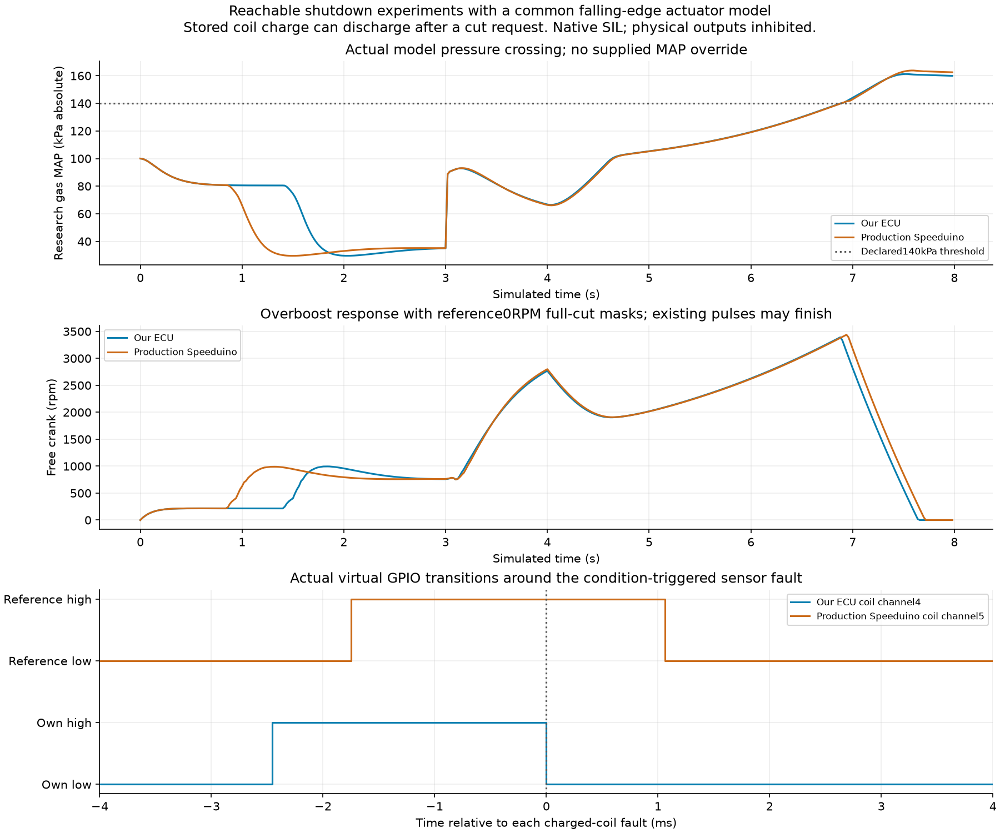

# Coupled turbo research evidence

This packet freezes28 completed Linux native experiments,14 profiles run independently with our controller and pinned production Speeduino. Each controller drives its own free-crank turbo research plant through actual fuel, ignition and boost GPIO transitions. Physical outputs remain inhibited.

The independent review accepts numerical, adapter and common-actuator consistency for these declared runs:28 cases,11,200 snapshots and no open findings in that scope. It does not accept full Speeduino parity, calibrated engine behavior, physical operation or the overall project goal. The [method, assumptions and reproduction commands](../../../docs/engine-turbo-benchmark.md) describe those limits.

| Check | Recorded result |
| --- | --- |
| Focused author tests |61 passed |
| Independent complete-run audits |28 passed;11,200 snapshots |
| Maximum complete energy residual |9.70µJ; unchanged0.02J acceptance gate |
| Maximum complete mass residual |1.95×10⁻¹⁵kg |
| Declared time-step comparisons |6 passed; largest measured difference0.238% against a2% limit |
| Executing project sources |96 exact file identities; separate own-library rebuild and live mapping checked |
| Independent review |315 regular evidence files; accepted only within the stated scope |

The scenarios cover disabled/zero/open/closed boost, step refinement, throttle closure, crank-capture loss, MAP rail, disconnected coil, stuck-open gate, a reachable charged-coil cut and an actual research-gas overboost crossing. Native CPU execution cost is zero. Engine, sensor and actuator parameters remain uncalibrated.

The140kPa gas experiment preserves a policy difference. Our controller cuts engine GPIOs and boost; the reference disables future engine scheduling, completes already active pulses and retains boost PWM while Running. Its reference protection cap is explicitly0RPM for this experiment. The inherited6500RPM profile remains separately tested. Neither is presented as a factory-default Speeduino defect.

The charged-coil case uses actual stored charge generated by the running model. Global cuts and scalar falling edges share discharge physics, so a cut can still release stored spark energy and burn trapped fuel. This corrects a rejected adapter revision. The older naturally aspirated plant's ideal external-quench path is a separate limitation.

## Inspect and verify

From the repository root:

```sh
python3 -B reports/engine/turbo-coupling/verify.py
python3 -B reports/engine/turbo-coupling/verify.py --repo .
```

The first command checks the closed file inventory, every archive member and raw consumed-edge/ADC/shutdown snapshots without executing archived code. The second also checks the96 executing source identities against the checkout. A later source revision can legitimately fail that additional comparison. Neither command reruns the gas solver or qualifies hardware.

- `study.tar.gz`: all28 raw traces, output edges, crank stimuli, tunes, results, command logs and provenance manifests. Original per-case audits and the original aggregate are retained.
- `sources.tar.gz`: exact executing project snapshots, reproduction/audit tools, cJSON sources and model Git identity records. This supplements the repository at base commit `fb8fade12cc6880267c5c69936d4580f2e68bd5a`; it is not a complete standalone checkout.
- `independent-review.tar.gz`: assessment, probes, audit results and the reviewer's exact315-file whitelist. Read `assessment.json` for the accepted scope and remaining limits.
- `rejected-history.tar.gz`: the first rejected fault study, its sources and the rejected charged-coil review. Original caches and earlier source copies remain intact locally.
- `comparison.json`: metrics computed from the raw runs, observed GPIO duty and finite step sensitivity. Its source hash and raw input hashes are recorded.
- `archive-inventory.json` and `artifact-manifest.json`: payload identities and the sealed packet inventory.

The original28-case aggregate remains failed because its parent loaded an author verifier with a decimal-string64-bit counter type error. `study/verification-result.json` is a separate fresh audit, binding198 original inputs and verifier/rechecker source hashes. All28 runs pass that audit. The independent reviewer checks those bindings and recomputes the budgets separately. No raw result was overwritten or silently relabelled.

Upstream linked executables and the original model ZIP/MDL are excluded. Fetch and verify the pinned model with `scripts/prepare_tcsi_source.py`; build the native production reference with the documented scripts. The source pins are TCSI `66a972d6c7206d258deb0c21b4cd6aded8a827e2` and Speeduino `9ff5aae44de51fdc00d3fb1c7c2bfc1f0d0b3e20`.

## Figures







Protected boost hardware/CAD, target/HIL and electrical measurements, actuator/engine calibration, supported current tuning-application acceptance, other missing engine features and physical qualification remain open in the [feature ledger](../../../docs/engine-feature-coverage.md).
